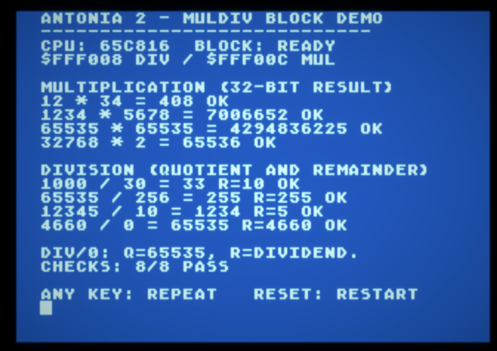

# antonia2_test_car — exercising the Antonia 2 MULDIV block from a cartridge

An 8 KB Atari cartridge at `$A000..$BFFF` that opens GRAPHICS 0 and puts the
**Antonia 2 hardware multiply/divide block** through eight cases, printing each
one and checking it against a constant:

```
MULTIPLICATION (32-BIT RESULT)
12 * 34 = 408 OK
1234 * 5678 = 7006652 OK
65535 * 65535 = 4294836225 OK
32768 * 2 = 65536 OK

DIVISION (QUOTIENT AND REMAINDER)
1000 / 30 = 33 R=10 OK
65535 / 256 = 255 R=255 OK
12345 / 10 = 1234 R=5 OK
4660 / 0 = 65535 R=4660 OK
```

Every printed number is read back from MMIO at `$FF:F008..$FF:F00F`, so the
arithmetic on screen is the block's, not a software routine's. The two extremes
are deliberate: `65535 × 65535 = 4294836225` needs the full 32-bit product, and
`4660 / 0` is the divide-by-zero convention (`Q=$FFFF`, `R=dividend`). Decimal
formatting is software — a powers-of-ten subtraction ladder — because
formatting a result is not the thing under test.

The program starts from the cartridge header with **no DOS of any kind
underneath it**, and never returns: any key repeats the run, RESET restarts it.

## Running it

In AltirraSDL select CPU **65C816**, and under **Configure System → CPU →
Additional options** tick **Antonia2 MULDIV Block**. Open `build/ant2test.car`
as a cartridge. No `.atdevice` file is needed.

**The program does not turn either of those on for you**, and says so rather
than computing something that looks like an answer: a missing 65C816 prints
`CPU 65C816 REQUIRED.` and a missing block prints
`ANTONIA2 BLOCK NOT DETECTED.`, each with the option to tick.

Both are detected rather than assumed. The CPU test is the usual pair — a
decimal-mode flag check for CMOS, then `CLC / XCE` for the 65816 — run with
NMIs masked and restored immediately afterwards, because the OS calls that
follow expect emulation mode. The block is detected by **two different
full-width results** (`7 × 9 = 63` and `1000 / 30 = 33 r10`), not by reading a
register and hoping the bus is not open.

## Building it

`do.bat` is the whole build:

```
orcam ANT2TEST.ASM keep=ANT2TEST
orcal ANT2TEST rc=ANT2.CFG keep=ANT2.HEX
makecart -m ANT2TEST.MAP
```

Three steps, three tools, and the same chain that builds `SDX.CAR` itself:

```
ANT2TEST.ASM --orcam---------------->  ANT2TEST.RT + ANT2TEST.A
             --orcal rc=CFG-------->   ANT2.HEX   (Intel HEX)
             --makecart -m MAP----->   ANT2TEST.CAR
```

Unlike `cpu_detect_car`, all three lines run natively today: `rc=` is ORCAL's
SDX spelling of `--rom-config`, and `MAKECART.COM` is the 65816 port of the
cartridge builder. On a real SDX disk the `[ROM]` manifest ends its lines with
ATASCII `$9B`, which is what the native linker reads; the copy in `src/` is a
host text file.

## `ant2test.cfg` — the ROM link map

The same kind of file as SpartaDOS X's `KRN.CFG`: a `[ROM]` header and one
placement per byte range.

```
[ROM]
LOAD ANT2TEST::MAIN AT=$A000 ROM=$0000
LOAD ANT2TEST::CARHDR AT=$BFFA ROM=$1FFA
```

`AT=` is where the bytes are assembled and executed; `ROM=` is their **offset
inside the image**, because Intel HEX record addresses are image offsets and not
Atari addresses. `RUN=` is only stated for a segment that is copied elsewhere
before it runs, so it is absent here — this cartridge executes in place.

`ANT2TEST::MAIN` does **not** name a segment. It names a byte range delimited by
a pair of global labels, which is what SDX's `MODULE_BEGIN` / `MODULE_END`
macros expand to:

```asm
__MODULE_BEGIN_MAIN entry
...
__MODULE_END_MAIN entry
```

`entry` defines the label where it stands and only sets the global flag: it
emits no bytes and does not advance the location counter, so the image is
exactly what it would be without the markers. Two pairs did not justify copying
the macro file in, so they are written longhand.

The gap between the two ranges is not described at all. A placement that
initializes nothing emits no record, so the hole costs nothing in the HEX and is
filled with `$FF` by `makecart` — 6778 of the image's 8192 bytes, since the
program and its tables are 1414.

## `ant2test.map` — the makecart recipe

This is the whole recipe:

```
[MAP]
CARTRIDGE TYPE=1 BANKSIZE=8K BANKS=1
IHEX ANT2.HEX
```

`[MAP]` mode states every address instead of measuring it, which is what a map
is for. The image size is `BANKS * BANKSIZE` and is never written down — two
numbers that have to agree are one number and one opportunity to disagree.
`TYPE=1` is "standard 8 KB", the first entry of the CART type list. Every byte
no record covers is filled with `$FF`.

No `BANKVECTOR`: the six bytes at `$BFFA` are the hardware's cartridge header,
placed by the Intel HEX like every other byte. No `CARFS` and no `ADD`, so not
one byte of directory is built — this cartridge holds no files. No `BANK` and
no `BANKORDER`, because there is no free area to begin and only one bank to
place.

## The cartridge header

The last six bytes of the image, emitted by `ant2test.asm` and by nothing else:

```asm
        org   $BFFA
CarHdr  start ANT2TEST
        dc    i2'CRUN'          $BFFA run vector
        dc    i1'0'             $BFFC cartridge present
        dc    i1'4'             $BFFD start it, no disk boot
        dc    i2'CINIT'         $BFFE init vector
```

`$BFFD` bit 2 starts the cartridge, bit 0 boots a disk first; `$04` is "start it
and do not go looking for a disk". The image ends `01 A0 | 00 | 04 | 00 A0`.

**`CINIT` is called early in cold start and must return**, long before the
screen exists, so it is a bare `RTS` at `$A000`. `CRUN`, at `$A001`, is taken at
the *end* of cold start, by which time the OS has opened `E:`; the program
reopens `S:` in mode 0 anyway so a repeat run starts from a known screen.

## RAM, and what a ROM cannot keep

Code and constants live in ROM at `$A000..$BFF9`; the header is `$BFFA..$BFFF`.
Every variable is therefore in RAM, on page 6 — the page the OS never uses —
and the program clears `$0600..$067F` on entry. Zero page `$CB/$CC` is the
inline-text pointer.

Three of those bytes are a report a debugger can read without touching the
program:

- `$0600` — state: 0 running, 1 all eight checks passed, 2 no block,
  3 65C816 required, 4 a result did not match
- `$0620..$0623` — the ASCII signature `ANT2`, so the report can be told apart
  from whatever else page 6 held
- `$0640..$065F` — the eight results **as actually read back**, four bytes each,
  little-endian: product32 for the multiplies, quotient16 then remainder16 for
  the divides

OS calls are made in emulation mode throughout, so the cartridge does not
require an OS that tolerates long stretches of native-mode execution.

## Acceptance, and what it does not cover

On 2026-10-25 the cartridge was run in AltirraSDL and the screen showed
**CPU: 65C816, BLOCK: READY, CHECKS: 8/8 PASS**, with every printed operation
also checked arithmetically.



That is the screen the paragraph above describes, so it can be read rather than
taken on trust — the header line names the two MMIO addresses the results were
read back from. Report and artifact identification:
[manual-verification.json](build/manual-verification.json).

That is a **manual** acceptance, and the gaps are part of the record: the
cartridge has not been driven automatically through a bridge, nor accepted on
FPGA, and the screenshot says nothing about the two mis-configuration paths. Nor
about the repeat-on-keypress loop — the bottom line is the *prompt* for it, and
a still frame cannot show that a key actually repeats the run.

## Where the artifacts came from

The `.car` checked in here was **first** built in a separate working tree, by
native ORCA/M and native ORCAL running under `lenkavm` with the host `makecart`,
and it is the exact file the screenshot above was taken from — `car_sha256` in
`manual-verification.json` identifies it. The driver that built it reached for
paths this repository does not have, so it was replaced by a `build.sh` written
in this tree's terms.

On 2026-10-25 that replacement was **run here, and all five artifacts came out
byte-identical** — `.rt`, `.a`, `.hex`, `.car`, `.rom` — with the `.car` still
`sha256 100c13ef…`, the hash the manual run was accepted against. So the two
chains agree, and the cartridge on the screenshot is the one this script writes.
That is a reproduction of the **bytes**; the acceptance of the *behaviour* is
still the single manual run described above.

## Layout

```
do.bat                  the build, as it runs on the Atari under SDX
src/ant2test.asm        the program, cartridge header and all
src/ant2test.cfg        the [ROM] link map for the ROM link
src/ant2test.map        the [MAP] recipe for makecart
build/
  ant2test.rt, .a       OMF objects from orcam, 1947 + 140 bytes
  ant2test.hex          Intel HEX from the ROM link, 91 data records + EOF
  ant2test.car          the cartridge, 8208 bytes            <- the artifact
  ant2test.rom          the same image unwrapped, 8192 bytes <- a by-product
  manual-screen.png     the accepted screen
  manual-verification.json
```

The `.car` checksum is `$001C2347`, which is the sum of the 8192 image bytes;
the sixteen bytes in front of them are `'CART'`, a big-endian type (1 = standard
8 KB), that checksum, and four zero bytes. An emulator that boots a raw ROM
image wants those sixteen gone, which is all `ant2test.rom` is.
